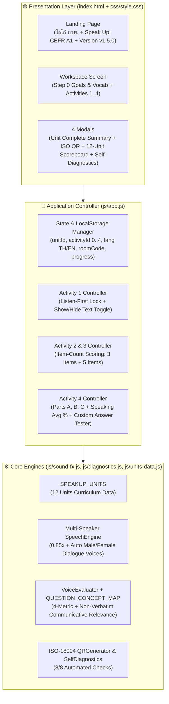

# 📘 สรุปการพัฒนา โครงสร้างระบบ ประเด็นปัญหาที่แก้ไขทั้งหมด และแนวทางการพัฒนาต่อยอด
**โครงการ:** Speak Up! CEFR A1 — Interactive Listening & Speaking Platform (12 Units)  
**รุ่นปัจจุบัน:** `v1.5.0 (Build 2026.10.25-COMM-EVAL)`  
**GitHub Repository:** [https://github.com/Doit-on/speak-up-CEFR-A1](https://github.com/Doit-on/speak-up-CEFR-A1)  
**Live URL:** [https://doit-on.github.io/speak-up-CEFR-A1/](https://doit-on.github.io/speak-up-CEFR-A1/)

---

## 1. ภาพรวมการพัฒนาตามลำดับเวอร์ชัน (`v1.0.0` → `v1.5.0`)

| เวอร์ชัน | สิ่งที่พัฒนาและอัปเดตหลัก | สถานะ |
| :--- | :--- | :---: |
| **`v1.0.0`** | สร้างระบบหลักสูตร **Speak Up! CEFR A1** ครบ 12 Units (48 Activities) จากเอกสาร `Speak Up A1.pdf` โดยใช้ `LocalStorage` แทน Google Drive/Sheets พร้อมระบบตรวจสอบตัวเองอัตโนมัติ (`SelfDiagnostics`) | ✅ สำเร็จ |
| **`v1.1.0`** | เพิ่มหน้า **Landing Page** แสดง **โลโก้ ทวพ.** คู่กับหัวข้อ **"Speak Up! CEFR A1"** และแสดงหมายเลข Version ระบบอย่างชัดเจน | ✅ สำเร็จ |
| **`v1.2.0`** | แก้ไขการกดเข้าสู่บทเรียน (`Enter Workspace`) และการสลับภาษา **ไทย–อังกฤษ (`TH / EN`)** ให้ทำงานครบทุกหน้าจอ | ✅ สำเร็จ |
| **`v1.2.1`** | ปรับปรุง **Activity 1** ให้ซ่อนทั้งชื่อเรื่องและเนื้อหาทั้งหมดไว้ 100% จนกว่าจะฟังเสียงอ่านครบทุกประโยคตั้งแต่ต้นจนจบ | ✅ สำเร็จ |
| **`v1.3.0`** | เพิ่มหน้า **Step 0: Learning Goals & Vocabulary** แสดงก่อนเข้า Activity 1 ทุก Unit (ตาราง `Vocabulary \| ความหมาย \| Example`) และอัปเกรด **Group QR Code** เป็นมาตรฐานสากล **ISO/IEC 18004** สแกนใช้งานได้จริง | ✅ สำเร็จ |
| **`v1.4.0`** | 1) ลบข้อความวงเล็บส่วนเกินในหน้า Learning Goals & คำศัพท์ 2) ปรับ Activity 1 เมื่อฟังจบต้องกดปุ่ม **`📖 แสดงเนื้อหา`** จึงจะเปิดข้อความ และมีปุ่ม **`🙈 ปิดเนื้อหาเพื่อฝึกฟัง`** พร้อมนำส่วน *Listen and repeat each phrase* ใน Activity 1 ออก 3) เพิ่ม **Pop-up สรุปคะแนนเมื่อทำครบ Unit** (แบบฝึกหัดแสดงตามจำนวนข้อ เช่น `3/3`, `5/5` และอ่านออกเสียงแสดงเป็น `% เฉลี่ยจากทุกข้อที่ทำ`) พร้อมปุ่มไปทำ Unit ต่อไปทันที 4) ปรับบทสนทนาให้เป็นการคุย 2 คนตามชื่อตัวละคร พร้อมแยก **เสียงผู้ชาย (Male Voice)** และ **เสียงผู้หญิง (Female Voice)** อัตโนมัติ | ✅ สำเร็จ |
| **`v1.5.0`** | อัปเกรด **Activity 4 — Part C: Challenge** (และ **Part B**) ให้กดฟังโจทย์และตัวอย่างก่อนปลดล็อกการตอบ พร้อมเพิ่ม **ระบบประเมินความสอดคล้องกับคำถามและการสื่อสาร (`Communicative Relevance Evaluator`)** โดย **ไม่จำเป็นต้องพูดตามประโยคตัวอย่าง** แต่ให้ตอบอยู่ในประเด็นที่คำถามต้องการ | ✅ สำเร็จ (ปัจจุบัน) |

---

## 2. สรุปประเด็นปัญหาและสิ่งที่ให้แก้ไขทั้งหมด (All Issues Raised & How They Were Solved)

| ลำดับ | ประเด็นปัญหา / สิ่งที่ต้องการให้แก้ไข | สาเหตุของปัญหา (Root Cause) | วิธีแก้ไขและไฟล์ที่ปรับปรุง (Solution Implemented) |
| :---: | :--- | :--- | :--- |
| **1** | **เพิ่มหน้า Landing Page ที่มีโลโก้ ทวพ., ประโยค "Speak Up! CEFR A1" และแสดง Version ระบบชัดเจน** | รุ่นแรก (`v1.0.0`) เปิดมาเข้าหน้าแบบฝึกหัดทันที ยังไม่มีหน้าปกต้อนรับขององค์กร | สร้างหน้า `#landing-screen` ใน `index.html` แสดงโลโก้ ทวพ. (`assets/twp-logo.png` พร้อม SVG สำรอง), ชื่อ **"Speak Up! CEFR A1"**, ป้าย Version ระบบ (`#top-version-badge`, `#landing-diag-badge`) และการ์ดเลือกทั้ง 12 Units |
| **2** | **เข้าระบบไปทำแบบฝึกหัดไม่ได้ และการเปลี่ยนภาษา อังกฤษ–ไทย (`TH / EN`) ไม่ทำงานตามที่ควรจะเป็น** | คลาส `.hidden` ของ Tailwind CDN ขัดแย้งกับ `style.display` ของ DOM และบางข้อความในหน้า Landing Page / Modal ยังไม่ได้ผูกกับพจนานุกรม `I18N` | กำหนด `.hidden { display: none !important; }` ใน `css/style.css` และอัปเกรดฟังก์ชัน `enterWorkspace` กับ `setLang` ใน `js/app.js` ให้สลับหน้าจอและแปลทุกปุ่ม/หัวข้อทันที |
| **3** | **ใน Activity 1 ต้องซ่อน Text ไว้ก่อน จนกว่าจะฟังการอ่านเนื้อหาเสร็จ** | การสั่งอ่านข้อความยาวรวดเดียวใน `window.speechSynthesis` อาจเกิดการตัดจบก่อนเวลา ทำให้ปลดล็อกเร็วเกินไป หรือยังแสดงชื่อเรื่องอยู่ก่อนฟังจบ | ปรับ `SpeechEngine.speak` ใน `js/sound-fx.js` ให้อ่านเรียงทีละประโยคพร้อมแถบความคืบหน้า (`ประโยคที่ X / Y`) และซ่อนทั้งชื่อเรื่องและเนื้อหาทั้งหมดจนกว่าจะอ่านจบครบทุกประโยค |
| **4** | **แสดง Learning Goals และตารางคำศัพท์ (`Vocabulary \| ความหมาย \| Example`) ของทุก Unit ตั้งแต่เข้า Unit ก่อนเข้า Activity 1 และตรวจสอบ QR เข้ากลุ่มให้สแกนได้จริง** | เดิมเมื่อคลิกเข้า Unit จะเปิด Activity 1 ทันที และ QR Code รุ่นแรกเป็นตารางจำลองที่กล้องมือถือสแกนไม่ได้ | 1) เพิ่ม **Step 0 (`#panel-0`)** ใน `renderStep0GoalsAndVocab` (`js/app.js`) ให้เปิดเป็นหน้าแรกเมื่อเข้าทุก Unit พร้อมปุ่มไป Activity 1 2) สร้าง `window.QRGenerator` (`js/diagnostics.js`) ตามมาตรฐาน **ISO/IEC 18004 (Reed-Solomon ECC)** สแกนด้วยกล้องมือถือและ LINE ได้จริง 100% |
| **5** | **ตัดข้อความในวงเล็บสีส้ม/ขีดทับในหน้า Learning Goals & ตารางคำศัพท์ออกทุก Unit** | มีข้อความขยายความในวงเล็บ เช่น `(สิ่งที่ผู้เรียนจะได้เรียนรู้ในบทนี้)`, `(Vocabulary • ความหมาย • Example)`, และ `(Meaning)` ที่เกินมาจากต้นฉบับ | แก้ไข `renderStep0GoalsAndVocab` (`js/app.js`) ให้แสดงเฉพาะ **`Learning Goals`**, **`ตารางคำศัพท์และประโยคตัวอย่าง`**, และหัวตาราง **`Vocabulary \| ความหมาย \| Example`** อย่างสะอาดตาครบทั้ง 12 Units |
| **6** | **ใน Activity 1 เมื่อฟังเสร็จแล้ว ต้องกดปุ่มเพื่อแสดงเนื้อหา และหากแสดงเนื้อหาแล้วมีปุ่มปิดเนื้อหาเพื่อฝึกฟังได้ พร้อมตัดส่วน Listen and repeat ใน Activity 1 ออก** | เดิมเมื่อฟังจบจะกางเนื้อหาสีแดงออกมาอัตโนมัติทันที และยังมีส่วน *Listen and repeat each phrase* ซ้ำซ้อนกับ Activity 4 | ปรับ `unlockAct1Now` และ `toggleAct1Text` (`js/app.js`) ให้เมื่อฟังจบแล้วต้องกดปุ่ม **`📖 แสดงเนื้อหา`** ก่อนจึงจะเห็นข้อความ และเมื่อเปิดแล้วมีปุ่ม **`🙈 ปิดเนื้อหาเพื่อฝึกฟัง`** สลับไปมาได้ตลอด พร้อมลบส่วน *Listen and repeat each phrase* ออกจาก Activity 1 ทุก Unit |
| **7** | **เมื่อทำครบ Unit ต้องมี Pop-up สรุปคะแนนแต่ละ Activity (แบบฝึกหัดแสดงเป็นคะแนนตามจำนวนข้อ และอ่านออกเสียงแสดงเป็น `%` เฉลี่ยจากทุกข้อที่ทำ) พร้อมปุ่มไปทำ Unit ต่อไปได้เลย** | เดิมแสดงคะแนนเป็น `%` ทั้งหมดและไม่มีหน้าต่างสรุปอัตโนมัติเมื่อทำจบแต่ละ Unit | สร้าง `getUnitDetailedStats` และ Modal **`#unit-complete-modal`** (`renderUnitCompleteModal` ใน `js/app.js`) แสดงคะแนนแบบฝึกหัดตามจำนวนข้อ (`Activity 2: X / 3 ข้อ`, `Activity 3: Y / 5 ข้อ`, รวม `8 ข้อ`) และคะแนนการอ่านออกเสียง (`Activity 4`) เป็น **`% เฉลี่ยจากทุกข้อที่ทำ`** พร้อมปุ่ม **`🚀 ไปทำ Unit ต่อไป →`** |
| **8** | **บทสนทนาที่มีการระบุชื่อ 2 ชื่อ ให้ปรับเป็นการคุย 2 คนตามบทสนทนา หากชื่อเป็นผู้ชายให้ใช้เสียงผู้ชาย หากชื่อเป็นผู้หญิงให้ใช้เสียงผู้หญิง** | ใน Unit 5 มีตัวละคร 3 ชื่อในบทเดียว และระบบเสียงเดิมใช้เสียงเดียวอ่านทุกตัวละคร | ปรับบทสนทนาใน `js/units-data.js` ให้เป็นการคุย 2 คน (เช่น `Sara` กับ `Dan`, `Emma` กับ `Jack`, `Mia` กับ `Tom`, `Nina` กับ `Max`) และอัปเกรด `window.SpeechEngine` (`js/sound-fx.js`) ให้ตรวจจับชื่อผู้พูด (`detectGenderByName`) แล้วสลับเสียงผู้ชาย (`Male Voice`, `pitch: 0.82`) และเสียงผู้หญิง (`Female Voice`, `pitch: 1.18`) โดยอัตโนมัติ |
| **9** | **ใน Part C: Challenge (และ Part B) ให้กดฟังโจทย์และตัวอย่างก่อน แล้วให้ผู้เรียนพูดตอบตามที่โจทย์ถาม โดยไม่จำเป็นต้องพูดตามประโยคตัวอย่าง แต่ต้องอยู่ในคำตอบที่คำถามต้องการ เพื่อดูว่าสื่อสารได้หรือไม่** | อัลกอริทึมเดิมเปรียบเทียบคำพูดของผู้เรียนกับประโยคตัวอย่าง (`item.sample`) แบบคำต่อคำ ทำให้ผู้เรียนที่ตอบตรงคำถามแต่ใช้คำอื่นได้คะแนนต่ำ | พัฒนา `QUESTION_CONCEPT_MAP` และ `evaluateCommunicativeRelevance` (`js/sound-fx.js`) ครอบคลุมทุกข้อของ Part B และ Part C ทั้ง 12 Units เพื่อตรวจ **Concept Slots (ประเด็นที่คำถามต้องการ)** แทนการบังคับพูดซ้ำประโยคตัวอย่าง พร้อมแสดงสถานะการสื่อสาร (**🟢 สื่อสารได้สำเร็จ** / **🟡 สื่อสารได้บางส่วน** / **🔴 ยังไม่ตรงกับคำถาม**) และช่องพิมพ์/แก้ไขคำตอบเพื่อทดสอบได้ทุกประโยค |

---

## 3. โครงสร้างสถาปัตยกรรมระบบปัจจุบัน (`v1.5.0`)

---

## 4. แนวทางการพัฒนาต่อยอดในอนาคต (Future Roadmap)

1. **เชื่อมต่อระบบ Cloud & Teacher Dashboard (Google Sheets / Firebase)**:
   - ส่งคะแนนแบบฝึกหัด (`X/8 ข้อ`), คะแนนพูดเฉลี่ย (`%`) และสถานะการสื่อสาร (`Communicative Pass`) ของผู้เรียนทุกคนใน `Room Code` เดียวกันขึ้นตารางรวมของอาจารย์ผู้สอนแบบ Real-time
2. **อัปเกรดระบบ AI Speech-to-Text & Semantic Grading (Whisper API / Gemini API)**:
   - เชื่อมต่อ API ถอดเสียงพูดและตรวจความหมายเชิงลึก (Semantic Understanding) เพื่อให้รองรับคำตอบปลายเปิดที่หลากหลายยิ่งขึ้นบนทุกเบราว์เซอร์ (รวมถึง Safari/iOS)
3. **ระบบใบประกาศนียบัตรดิจิทัล (TWP E-Certificate)**:
   - ออกใบประกาศนียบัตรพร้อมโลโก้ ทวพ. อัตโนมัติเมื่อผู้เรียนทำครบทั้ง 12 Units และผ่านเกณฑ์การประเมินการสื่อสาร
