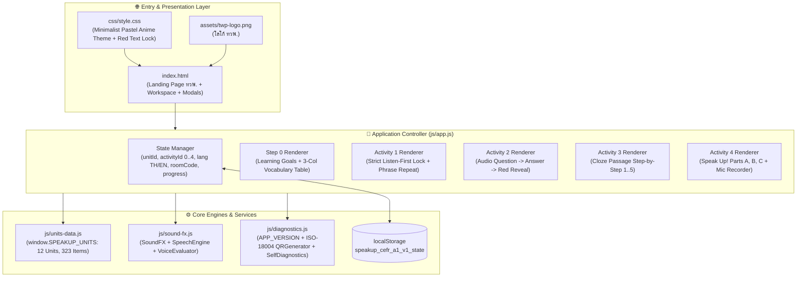

# 📘 สรุปโครงสร้างระบบ ฟังก์ชันการทำงาน ปัญหาอุปสรรค และแนวทางการพัฒนาต่อยอด
**โครงการ:** Speak Up! CEFR A1 — Interactive Listening & Speaking Platform (12 Units)  
**รุ่นปัจจุบัน:** `v1.3.0 (Build 2026.10.25-GOALS-QR)`  
**GitHub Repository:** [https://github.com/Doit-on/speak-up-CEFR-A1](https://github.com/Doit-on/speak-up-CEFR-A1)  
**Live URL:** [https://doit-on.github.io/speak-up-CEFR-A1/](https://doit-on.github.io/speak-up-CEFR-A1/)

---

## 1. โครงสร้างสถาปัตยกรรมระบบ (System Architecture)

ระบบถูกออกแบบด้วยสถาปัตยกรรม **Modular Data-Driven Single-Page Application (SPA)** โดยใช้ Vanilla JavaScript (ES6+), Tailwind CSS และ Web APIs มาตรฐาน (Web Speech API, MediaRecorder API, Web Audio API, Canvas 2D API) เพื่อให้ทำงานได้รวดเร็วบนทุกอุปกรณ์โดยไม่ต้องพึ่งพาเซิร์ฟเวอร์ประมวลผลหลังบ้านในระยะเริ่มต้น

### 1.1 โครงสร้างไฟล์ในโปรเจกต์ (Directory & File Structure)

| ไฟล์ / โฟลเดอร์ | บทบาทและหน้าที่หลัก | โมดูล / Global Object ที่ส่งออก |
| :--- | :--- | :--- |
| `index.html` | โครงสร้างหน้าเว็บหลัก แบ่งเป็น 2 หน้าจอใหญ่ (`#landing-screen` และ `#workspace-screen`), แถบ 5 ขั้นตอน (`#tab-0` ถึง `#tab-4`) และ 3 หน้าต่าง Modal (`#qr-modal`, `#score-modal`, `#diag-modal`) | DOM Containers |
| `css/style.css` | สไตล์มินิมอลพาสเทลอนิเมะ, แอนิเมชันตัวละคร Detective Kenji, คลื่นเสียง (`voice-wave`), การล็อกข้อความสีแดง (`.red-voice-text`) และคลาสซ่อนองค์ประกอบ (`.hidden`) | CSS Classes & Keyframes |
| `js/units-data.js` | ฐานข้อมูลหลักสูตรครบทั้ง **12 Units** อ้างอิงจาก `Speak Up A1.pdf` ประกอบด้วย Learning Goals, Vocabulary (`word`, `meaning`, `example`), และโจทย์ Activity 1–4 รวม 323 รายการ | `window.SPEAKUP_UNITS` |
| `js/sound-fx.js` | ระบบเสียงสังเคราะห์ (Web Audio API), ระบบอ่านออกเสียงภาษาอังกฤษช้าชัดเจน (`0.85x`) แบบเรียงประโยค และระบบประเมินการพูด 4 มาตรฐาน | `window.SoundFX`, `window.SpeechEngine`, `window.VoiceEvaluator` |
| `js/diagnostics.js` | ข้อมูลรุ่นระบบ (`v1.3.0`), ระบบสร้าง QR Code มาตรฐานสากล ISO/IEC 18004 และระบบตรวจสอบความสมบูรณ์ของระบบอัตโนมัติ 8 รายการ | `window.APP_VERSION`, `window.QRGenerator`, `window.SelfDiagnostics` |
| `js/app.js` | ตัวควบคุมหลักของแอปพลิเคชัน จัดการ State, การสลับภาษา `TH / EN`, การบันทึกคะแนนลง `localStorage`, การเข้ากลุ่มผ่าน URL Parameter และการส่งรายงานทาง Email | `window.SpeakUpApp` |
| `assets/twp-logo.png` | โลโก้ ทวพ. สำหรับแสดงบนหน้า Landing Page และแถบเมนูด้านบน | Image Asset |

### 1.2 โครงสร้างการจัดเก็บข้อมูล (`localStorage` Schema)
ระบบจัดเก็บความคืบหน้าไว้ที่คีย์ `speakup_cefr_a1_v1_state` ใน `localStorage` ของเบราว์เซอร์ โดยมีโครงสร้างดังนี้:
- `unitId`: บทเรียนปัจจุบัน (`1–12`)
- `activityId`: ขั้นตอนการเรียนปัจจุบัน (`0` = Goals & Vocab, `1–4` = Activity 1–4)
- `lang`: ภาษาของส่วนติดต่อผู้ใช้ (`"th"` หรือ `"en"`)
- `speechRate`: ความเร็วเสียงอ่าน (`0.85` เป็นค่าเริ่มต้น, ปรับได้ `0.75` หรือ `1.0`)
- `roomCode`: รหัสห้องเรียนกลุ่ม (เช่น `"CLASS-A1"`)
- `progress[unitId]`: เก็บสถานะการปลดล็อกและคะแนนรายกิจกรรม (`act1Unlocked`, `act1Score`, `act2Answers`, `act2Score`, `act3Answers`, `act3Step`, `act3Score`, `act4Records`, `act4Score`)

---

## 2. สรุปฟังก์ชันการทำงานหลัก (Core Functions)

1. **หน้าแรก (TWP Landing Page & Version Banner)**
   - แสดงโลโก้ **ทวพ.** คู่กับชื่อระบบ **"Speak Up! CEFR A1"** และป้ายสถานะรุ่นระบบ **`v1.3.0 • 8/8 OK`**
   - แสดงภาพรวมความก้าวหน้าทั้ง 12 Units (คะแนนเฉลี่ยรวม, จำนวน Unit ที่สำเร็จ) และการ์ดเลือกเข้าบทเรียนทั้ง 12 Units

2. **Step 0: เป้าหมายการเรียนรู้และตารางคำศัพท์ (`Learning Goals & Vocabulary`)**
   - แสดงผลทันทีเมื่อเข้าสู่แต่ละ Unit ก่อนเริ่มทำ `Activity 1`
   - แสดง **Learning Goals** ประจำบท และตาราง 3 คอลัมน์ (`Vocabulary | ความหมาย | Example`) พร้อมปุ่มกดฟังเสียงอ่านทีละคำหรือฟังต่อเนื่องทั้งหมด และปุ่มกดเข้าสู่ `Activity 1`

3. **Activity 1: Listen to the Story / Conversation / Fun Facts (เงื่อนไขฟังจบก่อนแสดงตัวอักษรสีแดง)**
   - ซ่อนทั้งชื่อเรื่องและเนื้อหาทั้งหมดไว้ในกรอบล็อกสีแดง จนกว่าผู้เรียนจะกดฟังเสียงอ่าน (`0.85x`) จนจบครบทุกประโยค
   - เมื่อฟังจบ ระบบจะปลดล็อกเนื้อเรื่องสีแดง (`Red Text`) พร้อมแสดงรายการประโยค **Listen and repeat each phrase** ให้กดฟังและฝึกพูดตามทีละประโยค

4. **Activity 2: Check Your Understanding (ฟังคำถาม -> ตอบก่อน -> เฉลยตัวสีแดง)**
   - ผู้เรียนกดฟังเสียงคำถามและเลือกตัวเลือก `a`, `b`, หรือ `c`
   - เมื่อเลือกคำตอบแล้ว ระบบจึงเปิดเผยประโยคคำถามสีแดง (`Red Question Text`) พร้อมตรวจคำตอบและคำนวณคะแนนทันที

5. **Activity 3: Listen Again and Complete the Sentence (ฟังและเติมคำทีละข้อ)**
   - มีปุ่มกดฟังเสียง Passage เต็ม และแสดงโจทย์เติมคำในช่องว่างทีละข้อ (ข้อ 1 ถึง 5)
   - ผู้เรียนต้องเลือกคำตอบของข้อปัจจุบันให้เสร็จก่อน ปุ่ม **"ข้อต่อไป (Next Question)"** จึงจะปลดล็อก

6. **Activity 4: Speak Up! (Parts A, B, C) พร้อมระบบอัดเสียงและประเมินการพูด 4 มาตรฐาน**
   - **Part A (Listen and repeat)**: ฟังประโยคตัวอย่าง -> กดปุ่มอัดเสียงพูดตาม -> กดฟังเสียงตัวเอง -> รับผลประเมิน
   - **Part B (Talk About Yourself)**: ระบบอ่านออกเสียงอัตโนมัติ 3 จังหวะ (*อ่านคำถาม -> อ่านตัวอย่างคำตอบ -> อ่านคำถามซ้ำอีกครั้ง*) -> กดอัดเสียงคำตอบของตัวเอง -> กดฟังเสียงตัวเอง
   - **Part C (My Daily Routine / Speaking Challenge)**: ฟังสถานการณ์และตัวอย่าง -> กดอัดเสียงพูดเล่าเรื่องของตนเอง 3–4 ประโยค -> กดฟังเสียงตัวเอง
   - **เกณฑ์การประเมินการพูด 4 มาตรฐาน (คิดเป็น % จาก 100%)**:
     1. **สำเนียงและการออกเสียง (Accent — 30%)**
     2. **ความครบถ้วนของเนื้อหา (Completeness — 30%)**
     3. **ความชัดเจนของเสียง (Clarity — 20%)**
     4. **เวลาและจังหวะในการพูด (Speaking Time — 20%)**
     - แสดงคำแนะนำรายบุคคลทั้งภาษาไทยและภาษาอังกฤษตามจุดที่ควรปรับปรุง

7. **ระบบ Group QR Code (ISO/IEC 18004) & รายงานผลทาง Email**
   - สร้าง QR Code มาตรฐานสากลที่เข้ารหัสลิงก์ `?unit=X&room=ROOM_CODE&lang=th` ให้ผู้เรียนสแกนด้วยกล้องมือถือหรือ LINE เพื่อเข้าสู่ Unit และห้องเรียนเดียวกันพร้อมกันทันที
   - สรุปคะแนนราย Activity (1–4), คะแนนรวมราย Unit และคะแนนเฉลี่ยทั้ง 12 Units พร้อมส่งออกรายงานผ่าน Email (`mailto:`)

---

## 3. ปัญหาและอุปสรรคในการพัฒนา พร้อมแนวทางแก้ไข (Challenges & Technical Solutions)

| ลำดับ | ปัญหาและอุปสรรคที่พบ | สาเหตุทางเทคนิค (Root Cause) | แนวทางแก้ไขที่ใช้งานในระบบปัจจุบัน (Solution) |
| :---: | :--- | :--- | :--- |
| **1** | **Activity 1 ปลดล็อกข้อความสีแดงก่อนที่เสียงอ่านจะจบจริง หรือเสียงอ่านหยุดกลางคันสำหรับเนื้อเรื่องยาว** | `window.speechSynthesis` ในเบราว์เซอร์ตระกูล Chromium มีบั๊ก Garbage Collection กับออบเจกต์ `SpeechSynthesisUtterance` เมื่อข้อความยาวเกิน ~200 ตัวอักษร หรือสั่ง `cancel()` ซ้อนกัน ทำให้ `onend` ถูกเรียกก่อนเวลาอันควร | ปรับปรุง `SpeechEngine.speak` ใน `js/sound-fx.js` ให้แยกเนื้อเรื่องออกเป็นประโยคย่อย (`splitIntoSentences`) แล้วอ่านเรียงทีละประโยค เก็บ Reference ไว้ใน `activeUtterance` และคำนวณเวลาขั้นต่ำตามจำนวนคำ (`minDurationMs`) ก่อนอนุญาตให้ปลดล็อกข้อความสีแดง |
| **2** | **QR Code แบบจำลองในรุ่นแรกไม่สามารถสแกนด้วยกล้องมือถือจริงได้** | การวาดตารางพิกเซลแบบ Hash ทั่วไปไม่มีข้อมูล Format Information และไม่มีรหัสแก้ไขข้อผิดพลาด Reed-Solomon ตามมาตรฐานสากล | พัฒนาโมดูล `window.QRGenerator` ใน `js/diagnostics.js` ขึ้นมาใหม่ทั้งหมดตามมาตรฐาน **ISO/IEC 18004** (Byte Mode, Galois Field `GF(256)` Reed-Solomon ECC Level L, Mask Pattern 0, Format Bits `0x77C4`, รองรับ Versions 1–6) ทำให้สแกนผ่านกล้อง iOS/Android และ LINE ได้จริงโดยไม่ต้องพึ่งไลบรารีภายนอก |
| **3** | **การกดเข้าบทเรียนจากหน้า Landing Page หรือการสลับภาษา `TH / EN` ไม่เปลี่ยนหน้าจอในบางจังหวะ** | ความขัดแย้งระหว่างคลาส `.hidden` ของ Tailwind CSS ที่โหลดผ่าน CDN กับการตั้งค่า `element.style.display` และการผูก Event Listener ก่อน DOM โหลดเสร็จ | กำหนด `.hidden { display: none !important; }` ใน `css/style.css` ควบคู่กับการจัดการทั้ง `classList` และ `style.display` ใน `renderAll` และตรวจสอบ `document.readyState` ก่อนเริ่มต้นระบบ |
| **4** | **ความแตกต่างของการรองรับ `SpeechRecognition` บนแต่ละเบราว์เซอร์ (เช่น Safari / Firefox / ใช้งานออฟไลน์)** | Web Speech-to-Text (`webkitSpeechRecognition`) รองรับเต็มรูปแบบเฉพาะบน Chrome/Edge ที่เชื่อมต่ออินเทอร์เน็ต หากเปิดบนเบราว์เซอร์อื่นอาจไม่ได้ข้อความ Transcript | ออกแบบ `VoiceEvaluator.evaluate` ให้เป็นระบบ **Hybrid Evaluation**: หากมี Transcript จะวัดความแม่นยำรายคำควบคู่กับระยะเวลาพูด แต่หากเบราว์เซอร์ไม่รองรับ Speech-to-Text ระบบจะวิเคราะห์จากความยาวคลื่นเสียง (`DurationMs` เทียบกับจำนวนคำเป้าหมาย) เพื่อให้ผู้เรียนอัดเสียง ฟังเสียงตัวเอง และได้คะแนนประเมิน 4 ด้านเสมอ |
| **5** | **ข้อจำกัดความจุของ `localStorage` (~5 MB ต่อโดเมน)** | หากแปลงไฟล์เสียงที่อัด (`Audio Blob`) เป็น Base64 เก็บลง `localStorage` ทุกข้อ พื้นที่จะเต็มภายใน 1–2 Units | แยกการจัดเก็บเป็น 2 ส่วน: เก็บไฟล์เสียงไว้ในหน่วยความจำ (`sessionAudioBlobs`) เพื่อให้กดฟังเสียงตัวเองซ้ำได้ทันทีระหว่างเรียน และบันทึกเฉพาะคะแนน (`%`) กับข้อความที่ถอดเสียงได้ลง `localStorage` |

---

## 4. แนวทางการพัฒนาต่อยอดในอนาคต (Future Development Roadmap)

### ระยะที่ 1: เชื่อมต่อระบบ Cloud Backend & Teacher Dashboard (Google Sheets / Firebase)
- **สิ่งที่พัฒนาเพิ่ม**: สร้างไฟล์ `google-apps-script/Code.gs` เชื่อมต่อกับ `SpeakUpApp` เพื่อส่งคะแนนของนักเรียนทุกคนที่อยู่ใน `Room Code` เดียวกันขึ้น Google Sheet แบบ Real-time
- **ประโยชน์**: อาจารย์ผู้สอนสามารถเปิดหน้า Dashboard ดูได้ทันทีว่าในห้องเรียนกลุ่ม (`?room=CLASS-A1`) มีนักเรียนเข้าเรียนกี่คน ใครทำถึง Activity ไหน และได้คะแนนเท่าไหร่โดยที่นักเรียนไม่ต้องกดส่ง Email ด้วยตัวเอง

### ระยะที่ 2: ระบบจัดเก็บไฟล์เสียงแบบ Hybrid (Optional Google Drive / Cloud Storage)
- **สิ่งที่พัฒนาเพิ่ม**: เพิ่มปุ่มอัปโหลดไฟล์เสียงเฉพาะ **Activity 4 — Part C (Speaking Challenge)** ขนาดเล็ก (`.webm` / `.mp4` ประมาณ 40–80 KB ต่อไฟล์) ขึ้น Google Drive พร้อมแนบลิงก์ไฟล์เสียงลงในแถวคะแนนของนักเรียนใน Google Sheet
- **ประโยชน์**: ประหยัดพื้นที่จัดเก็บและทำให้ครูสามารถกดฟังไฟล์เสียงการพูดสรุปของผู้เรียนย้อนหลังได้

### ระยะที่ 3: ยกระดับเสียงอ่านและ AI ประเมินการพูดระดับพยางค์ (Neural Audio & AI Speech API)
- **สิ่งที่พัฒนาเพิ่ม**:
  1. รองรับไฟล์เสียง MP3 ต้นฉบับควบคู่กับ Web Speech TTS (หากมีไฟล์ `assets/audio/unit-1-act1.mp3` ให้เล่นไฟล์ MP3 ก่อน หากไม่มีจึงสลับไปใช้ `SpeechEngine` อัตโนมัติ)
  2. เชื่อมต่อ API ประเมินการออกเสียงระดับ Phoneme (เช่น Azure AI Speech Pronunciation Assessment หรือ OpenAI Whisper API) แทนที่ Web Speech Recognition พื้นฐานของเบราว์เซอร์

### ระยะที่ 4: Progressive Web App (PWA) & ระบบใบประกาศนียบัตร (E-Certificate)
- **สิ่งที่พัฒนาเพิ่ม**:
  1. เพิ่มไฟล์ `manifest.json` และ `service-worker.js` เพื่อให้ผู้เรียนสามารถกด **"Add to Home Screen"** ติดตั้งเป็นแอปพลิเคชันบนมือถือหรือแท็บเล็ตและใช้งานแบบ Offline ได้ 100%
  2. เพิ่มระบบสร้าง **ใบประกาศนียบัตรดิจิทัล (PDF / PNG E-Certificate พร้อมโลโก้ ทวพ.)** อัตโนมัติเมื่อผู้เรียนทำครบทั้ง 12 Units และได้คะแนนเฉลี่ยรวมผ่านเกณฑ์ที่กำหนด
